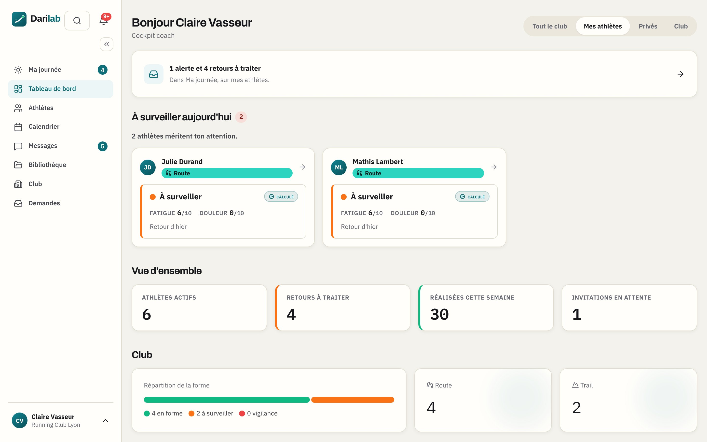
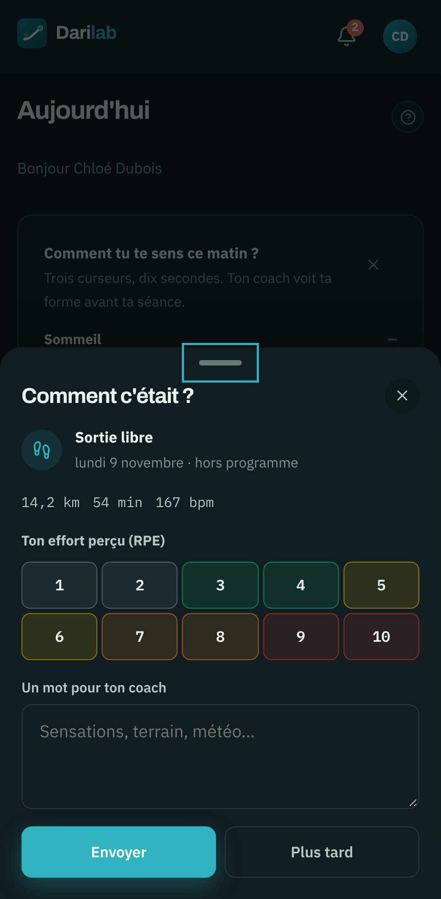

# DARI Lab — coaching course à pied et préparation physique

> Le coach prescrit des séances **en fourchettes** calculées pour chaque athlète à partir de sa
> physiologie (seuils lactiques, VDOT, vitesse critique, domaines d'intensité, 1RM). L'athlète suit
> son programme sur son téléphone, envoie ses retours, et ses sorties reviennent seules de sa
> montre.
>
> Monorepo **Angular 21 (PWA) + Spring Boot 3.5 / Java 21 + PostgreSQL 18**. Production :
> [www.darilab.app](https://www.darilab.app).

<p align="center">
  
  
</p>

**En images** : [guide du coach](docs/guides/GUIDE-COACH.md) ·
[guide de l'athlète](docs/guides/GUIDE-ATHLETE.md) · [captures](docs/captures/) ·
**Documentation** : [index `docs/`](docs/README.md)

---

## Sommaire

- [Fonctionnalités](#fonctionnalités)
- [Moteurs de calcul](#moteurs-de-calcul)
- [Stack technique](#stack-technique)
- [Démarrage rapide (Docker)](#démarrage-rapide-docker)
- [Comptes de démonstration](#comptes-de-démonstration)
- [Développement sans Docker](#développement-sans-docker)
- [Base de données](#base-de-données)
- [Tests et CI](#tests-et-ci)
- [Structure du dépôt](#structure-du-dépôt)
- [Sécurité et RGPD](#sécurité-et-rgpd)
- [Configuration et déploiement](#configuration-et-déploiement)
- [Limites connues](#limites-connues)
- [Conventions](#conventions)

---

## Fonctionnalités

Trois espaces : **coach** (`/app`, seul ou en club, avec adjoints et permissions), **athlète**
(`/athlete`, PWA mobile) et **administrateur plateforme** (`/admin`).

### Course à pied
- **Profil physiologique** : performances → VDOT et allures d'entraînement ; LT1/LT2, vitesse
  critique (saisies ou calculées par test), domaines d'intensité, FC de seuil.
- **Zones paramétrables** : plusieurs modèles par club (route, trail, débutant…), appliqués
  athlète par athlète ; les cibles se recalculent quand une référence change.
- **Bibliothèque et éditeur de séances** : échauffement / corps / retour au calme, prescrits par
  zone ou en fourchette de % (« 6 × 1000 m à 102–106 % VC »), répétitions à plusieurs allures,
  éducatifs attachables, calculateur en direct par athlète.
- **Calendrier** (course, force, test, objectif, indisponibilité) : glisser-déposer, copier-coller,
  semaine dupliquée, mésocycle, plan construit depuis l'objectif. Prescription figée à la
  planification.
- **Planification de groupe** : une ligne par athlète ; une séance collée pour tout le groupe est
  **recalculée pour chacun** ; « Adapter la structure » ajuste la séance d'un seul athlète.

### Préparation physique
- Bibliothèque d'exercices (consignes, contre-indications, vidéo YouTube/Vimeo lue au clic) et de
  séances rangées par catégorie.
- Formats Classique, EMOM, AMRAP, For Time, Circuit, Isométrie, Pliométrie ; drop-set, super-set,
  myo-reps, cluster ; volume en répétitions, durée ou distance, latéralité, tempo, repos.
- Charges calculées depuis le 1RM (Nuzzo par défaut, Epley, Brzycki, RIR), tests 1RM
  (4 protocoles), cycles de force, progression automatique et alertes coach.
- Une séance se crée, se modifie et se copie directement sur le calendrier ; chez un autre athlète,
  les charges sont recalculées avec **son** 1RM.

### Suivi
- **Retour de séance** en trente secondes (RPE, fatigue, douleur, commentaire) et **check-in** du
  matin. Pastille de forme calculée sur fatigue et douleur, **jamais sur le RPE**.
- **Prévu / réalisé** : chaque sortie importée est rapprochée de sa séance (sport, date, volume,
  titre) ; sans preuve suffisante, rien n'est rattaché. Score de réalisation bloc par bloc.
- **Charge** : sRPE, ATL/CTL, ACWR course + force, monotonie, charge mécanique / métabolique.
- **Tableau de bord** et **« Ma journée »** : athlètes à surveiller, retours à lire, alertes.
- Export PDF du programme et du bilan d'un athlète.

### Montres et sorties

| Source | Statut | Ce qui circule |
|---|---|---|
| **Strava** | En production | Sorties importées (webhook + filet horaire), renommage optionnel sur Strava |
| **Garmin Connect** | **Bêta** — accès Garmin obtenu le 13/11/2026, premier test réel en cours | Séances course **et** renforcement des 14 prochains jours envoyées sur la montre ; sorties reçues dès leur synchronisation |
| **COROS** | **Bêta** — activée par `COROS_ENABLED` | Séances course des 14 prochains jours envoyées sur la montre ; sorties importées toutes les heures |
| **Fichier** | En production | Import FIT, GPX, TCX (décodeurs maison) et saisie manuelle |

La connexion est toujours faite **par l'athlète**. Une même sortie arrivée par deux sources n'est
comptée qu'une fois. Détails, limites et exploitation :
[`docs/INTEGRATIONS-MONTRES.md`](docs/INTEGRATIONS-MONTRES.md).

### Communication
- **Messagerie temps réel** (SSE) : conversation par athlète, fil de groupe et de club, pièces
  jointes. Les échanges sur une séance se lisent aussi **sur la séance**.
- Notifications **push** (Web Push / VAPID) et **e-mail** (Resend), heures calmes, digest coach
  de 7 h, bilans hebdomadaires.

### Hub : annuaire et mise en relation
- **Annuaire public** des coachs (`/coachs`) : recherche, filtres, tri, fiche publique relue par
  l'équipe avant publication.
- **Demande de coaching** écrite dès l'inscription de l'athlète ; le coach accepte, refuse ou pose
  une question. Coordonnées jamais exposées. Fin de relation à tout moment.
- Compte athlète **autonome**, sans club ni invitation.

### Découverte
- **Essayer sans inscription** (page d'accueil) : un espace coach jetable par visiteur, rempli
  comme la démonstration, côté coach et côté athlète, **effacé au bout de 24 h**.
- **Aide** par rôle avec recherche et liens contextuels, aide publique (`/aide`) et guides PDF
  illustrés, vidéo de présentation.

### Administration
Centre de pilotage `/admin` (double authentification obligatoire) : anomalies actionnables,
comptes, clubs, athlètes, invitations, demandes de club, fiches coachs à relire, e-mails,
configuration réelle de l'instance, **journal d'audit**. Gestes de support journalisés (renvoi de
vérification, lien de mot de passe, fermeture des sessions, suspension, « voir en tant que »)
sans jamais accéder à la base ni voir un mot de passe.

---

## Moteurs de calcul

Toute la physiologie vit dans des **moteurs Java purs** (`com.coachrun.engine`), testés
unitairement, recalculés à la sauvegarde.

| Moteur | Entrées → sorties | Référence |
|---|---|---|
| `VdotEngine` | performances → VDOT + allures | Daniels / Riegel `T2 = T1·(D2/D1)^1.06` |
| `LactateThresholdEngine` | paliers lactate → LT1 / LT2 | LT1 = baseline + 0,5 ; LT2 = Dmax modifié |
| `IntensityDomainEngine` | vitesse/FC + profil → domaine 1/2/3 | physio (LT1/LT2), repli FC |
| `SessionCalculatorEngine` | bloc + profil → allure/FC/RPE/durée | fourchettes min–max |
| `LoadEngine` | sRPE → ATL/CTL/ratio/monotonie | ACWR course + force |
| `FormStatusEngine` | fatigue + douleur → forme | **jamais** le RPE |
| `OneRmEngine` | charge/reps/(RIR\|RPE) → e1RM + zones | Nuzzo (104,9) par défaut |
| `StrengthChargeEngine` | prescription + 1RM → charges (kg) | palier 2,5 kg |
| `StrengthLoadEngine` | séries réalisées → charge méca / métab (UA) | Σ(charge×reps×%1RM)/100 ; sRPE |
| `ProgressionEngine` | réalisé vs prescrit → suggestion + alertes | +2,5/+5 kg ; douleur/RPE/RIR |
| `ComplianceEngine`, `PhysioDetectionEngine`, `TrajectoryEngine`, `SessionAdaptationEngine`, `PlanBuilderEngine`, `WeekOutlookEngine` | couche de décision : réalisation, détection physio, projection, adaptation, plan depuis l'objectif | **le produit ne modifie jamais une séance seul** |

---

## Stack technique

| Couche | Techno |
|---|---|
| Front | Angular 21 (standalone, signals, OnPush), PWA, TypeScript 5.9, Leaflet |
| Back | Spring Boot 3.5, Java 21, API REST, Springdoc/OpenAPI |
| Données | PostgreSQL 18, **Liquibase** (`ddl-auto: none`) |
| Auth | JWT court + jeton de rafraîchissement, sessions révocables, 2FA administrateur |
| Intégrations | Strava, Garmin Connect (OAuth 2.0 PKCE, Training + Activity API), COROS (COROS MCP), Resend, Web Push, OpenPDF |
| Temps réel | Server-Sent Events |
| Hébergement | Railway (back + base), Vercel (front), DNS OVH |
| CI | GitHub Actions : build, tests, e2e Playwright, CI nocturne (suites complètes + vulnérabilités), sauvegarde et test de restauration hebdomadaire |

---

## Démarrage rapide (Docker)

Prérequis : Docker Engine ≥ 24 démarré, Compose v2 (`docker compose`), ~4 Go de RAM.
**Aucun fichier de configuration à créer** : `docker-compose.yml` porte ses valeurs de
développement.

```bash
git clone <url-du-repo> && cd coach-app
docker compose up --build           # 5 à 10 min la première fois
```

Compose démarre `postgres`, puis `backend` (migrations + jeu de démonstration en profil `dev`),
puis `frontend` (nginx, qui relaie `/api`). Prêt quand le journal affiche
`[seed dev] Jeu de démo prêt`.

| Service | URL |
|---|---|
| **Application** | http://localhost:4200 — la seule à ouvrir |
| API | http://localhost:8081/api (`/public/ping`, `/actuator/health`, `/swagger-ui.html`) |
| PostgreSQL | `localhost:5432`, `postgres` / `postgres`, base `coachrun` |

Port déjà pris : `FRONTEND_PORT=4300 BACKEND_PORT=8082 POSTGRES_PORT=55432 docker compose up -d`.

```bash
docker compose logs -f backend          # journaux
docker compose up -d --build backend    # reconstruire après modification
docker compose down                     # arrêter (données conservées)
docker compose down -v                  # ⚠ arrêter et effacer la base
```

| Symptôme | Solution |
|---|---|
| `Cannot connect to the Docker daemon` | démarrer Docker |
| `address already in use` | changer les ports (ci-dessus) |
| `container coachrun-backend is unhealthy` | `docker compose logs backend` ; le premier démarrage est le plus long |
| Ancienne version du front après rebuild | service worker : rechargement forcé ou onglet privé |
| `JavaScript heap out of memory` | donner ~4 Go à Docker |
| Erreur PostgreSQL après changement d'image | `docker compose down -v` (⚠ données locales perdues) |

Points d'arrêt, journaux, `correlationId` : [`docs/DEBUG.md`](docs/DEBUG.md).

---

## Comptes de démonstration

Mot de passe commun : **`password1234`** (profil `dev` uniquement).

| Rôle | E-mail |
|---|---|
| Administrateur (2FA à l'enrôlement) | `admin@coachrun.fr` |
| Responsable de club — **Claire Vasseur** | `demo@coachrun.fr` |
| Coach adjoint — Hugo Perrin | `coach@coachrun.fr` |
| Athlète — Chloé Dubois | `athlete@coachrun.fr` |
| Coachs indépendants, fiche publiée | `sarah@coachrun.fr`, `malik@coachrun.fr` |
| Coach, fiche en attente de relecture | `julie@coachrun.fr` |
| Athlète du hub, sans coach / demande en attente | `nina@coachrun.fr` / `tom@coachrun.fr` |

Le jeu est déterministe (`DemoSeedService`) : profils, tests, séances course et force, charge,
objectifs, conversations, deux semaines planifiées, cinq coachs dans l'annuaire. `seedHub()` et
`seedShowcase()` ne tournent qu'au démarrage, pas dans les tests.
2FA admin à refaire en local : `delete from mfa_credentials; delete from mfa_recovery_codes;`.

---

## Développement sans Docker

Prérequis : JDK 21, Node 20+, PostgreSQL avec une base `coachrun` (ou
`docker compose up -d postgres`).

```bash
cd back && ./mvnw spring-boot:run       # http://localhost:8080/api, profil dev
cd front && npm install && npm start    # http://localhost:4200, proxy /api → 8080
```

Aucun `.env` requis en dev. Pour brancher Strava, Resend, Sentry… : copier
[`.env.example`](.env.example) et exporter les variables voulues.

| Commande front | Usage |
|---|---|
| `npm run build` | build de production (Vercel) |
| `npm run start:pwa` | build PWA + service worker, pour tester le push |
| `npm test` | tests unitaires |

---

## Base de données

- Schéma piloté **uniquement par Liquibase**, appliqué à chaque démarrage. Toute modification
  passe par un nouveau changeset.
- Sauvegarde chiffrée quotidienne et **test de restauration automatique** chaque lundi
  (GitHub Actions) : [`docs/OPERATIONS.md`](docs/OPERATIONS.md) §1-2.

```bash
docker compose exec postgres psql -U postgres -d coachrun
docker compose exec -T postgres pg_dump -U postgres coachrun > sauvegarde.sql
```

---

## Tests et CI

```bash
cd back && ./mvnw -B -ntp clean verify   # ~1 100 tests (moteurs + intégration MockMvc, H2 mode PG)
cd front && npm run build && npm test    # build AOT + ~500 tests unitaires
cd e2e && npx playwright test            # parcours de bout en bout (cf. e2e/README.md)
```

| Workflow | Quand | Quoi |
|---|---|---|
| `ci.yml` | chaque push / PR | back, smoke test sur PostgreSQL réel, front, e2e Playwright |
| `nocturne.yml` | chaque nuit | suites complètes, temps de démarrage, vulnérabilités (dérogations datées dans `vulnerabilites-acceptees.tsv`) |
| `deploy-tag.yml` | CI de `main` verte | tag `prod-AAAA-MM-JJ-HHMM-<sha>` pour revenir en arrière |
| `db-backup.yml` / `db-restore-test.yml` | quotidien / lundi | sauvegarde chiffrée, restauration vérifiée |

---

## Structure du dépôt

```
back/    API Spring Boot — controller, service, engine, entity, dto, security,
         integration (Strava, Garmin, COROS, Resend), trial (essai jetable),
         resources/db/changelog (Liquibase)
front/   Angular — core (services, modèles, gardes), features (un dossier par écran),
         branding (icônes, og-image, vidéo, guides PDF)
e2e/     Playwright — parcours et script de captures d'écran
docs/    documentation (index : docs/README.md)
ops/     scripts d'exploitation (sauvegarde, preflight prod)
```

---

## Sécurité et RGPD

- Données de santé et jetons OAuth **chiffrés au repos** (AES-256-GCM).
- Cloisonnement par club et par relation coach-athlète vérifié sur chaque accès (anti-IDOR, tests
  d'accès dédiés).
- JWT jamais dans une URL ; jetons d'usage unique d'une minute pour SSE et pièces jointes.
- Démarrage **refusé en prod** si un secret manque ou garde sa valeur de dev.
- CSP stricte, CORS en liste blanche, limitation de débit, 2FA administrateur.
- Consentement santé horodaté, export et suppression de compte par l'athlète, journal d'audit
  sans donnée de santé ni secret. Aucune donnée n'alimente un système d'IA.

---

## Configuration et déploiement

- **Back + PostgreSQL → Railway**, **front → Vercel**, domaine `www.darilab.app`.
- Variables : modèle commenté dans [`.env.example`](.env.example), tableau complet dans
  [`docs/DEPLOIEMENT.md`](docs/DEPLOIEMENT.md) §3. La stack Docker n'en demande aucune.
- Avant de passer en prod : `./ops/preflight-prod.sh`.
- Exploitation (sauvegardes, Sentry, journaux, version en ligne, retour arrière) :
  [`docs/OPERATIONS.md`](docs/OPERATIONS.md).

Chaque intégration se coupe proprement sans ses variables : sa carte affiche « indisponible »
ou « Bientôt », rien d'autre ne change.

---

## Limites connues

- Tests d'intégration sur H2 (mode PostgreSQL) ; seul un smoke test tourne sur PostgreSQL réel.
- SSE, jetons de flux et liste noire de jetons en mémoire : **une seule instance** de back.
- Pièces jointes en base (`bytea`) ; stockage objet à prévoir à plus grande échelle.
- Garmin et COROS en bêta : formats à confirmer sur de vrais comptes ; COROS ne permet pas de
  supprimer une séance envoyée.
- Reliquat suivi dans [`docs/PLAN-CONFORMITE-BETA-2026-08.md`](docs/PLAN-CONFORMITE-BETA-2026-08.md).

---

## Conventions

- Nommage **anglais dans le code**, libellés **français dans l'interface**.
- Entités héritant de `BaseEntity`, DTO Request/Response séparés, scoping club systématique.
- Composants Angular standalone, `inject()`, signals + OnPush.
- Détail : [`docs/Claude.md`](docs/Claude.md).

Licence : privée, tous droits réservés.
