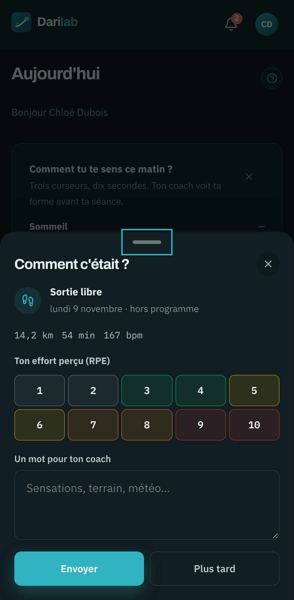
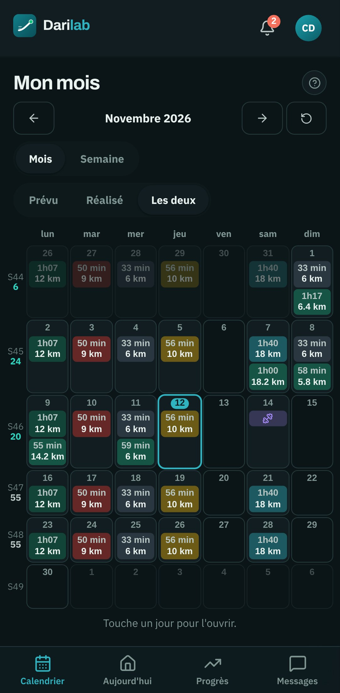
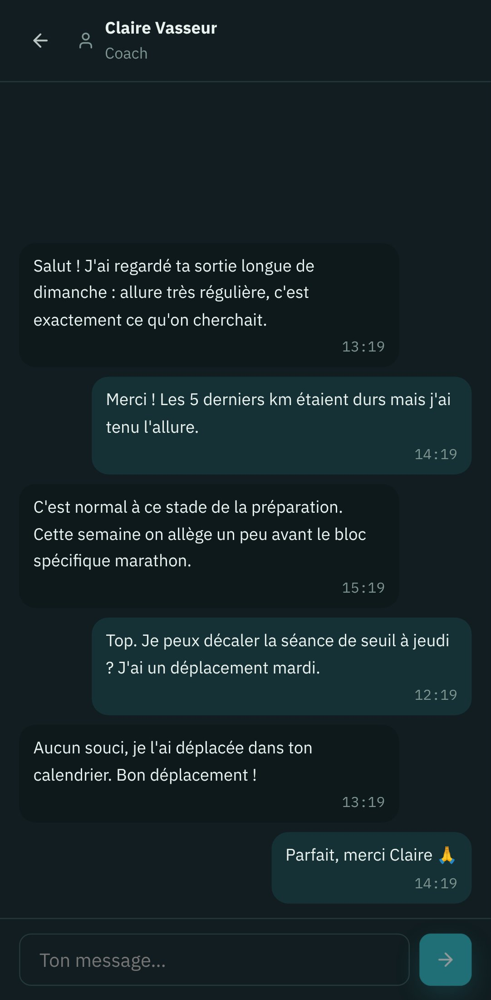
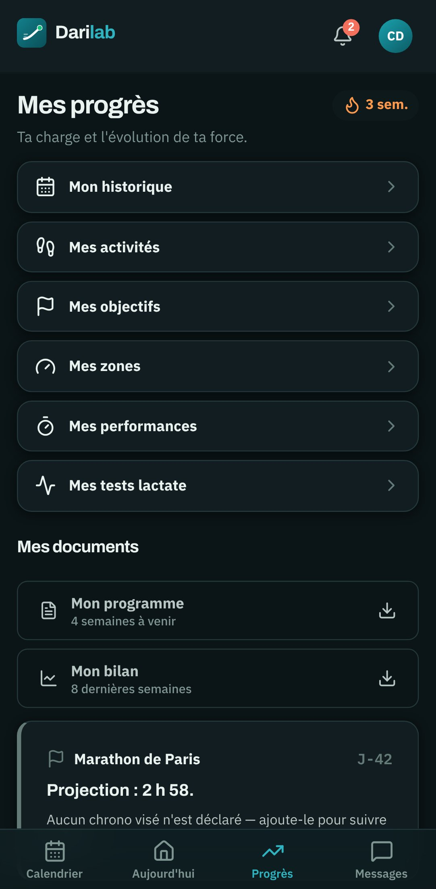

# Guide de l'athlète

> Pour les athlètes suivis par un coach sur DARI Lab. Les images viennent du compte de
> démonstration (`athlete@coachrun.fr`, Chloé Dubois).

DARI Lab s'utilise sur le téléphone, comme une application : depuis le navigateur, « Ajouter à
l'écran d'accueil » l'installe et active les notifications.

| Aujourd'hui | Mon mois | Messages | Mes progrès |
|---|---|---|---|
|  |  |  |  |

## Aujourd'hui

Le matin, trois curseurs (sommeil, fatigue, douleur) en dix secondes : votre coach voit votre forme
avant la séance. En dessous, la séance du jour avec ses allures cibles, calculées pour vous, et le
compte à rebours jusqu'à votre objectif.

## Mon mois

Le calendrier du mois : une case par jour, la durée et la distance de chaque séance, une couleur
par type. On voit le prévu, le réalisé, ou les deux. Toucher un jour l'ouvre. Une séance peut être
déplacée à un autre jour.

## Après la séance

Un retour en trente secondes : l'effort perçu de 1 à 10, la fatigue, la douleur et un mot pour
votre coach. Si votre montre est reliée (Strava), la sortie se rattache seule à la séance prévue.

## Messages

La conversation avec votre coach, et les fils de votre groupe et de votre club.

## Mes progrès

Votre historique, vos activités, vos objectifs, vos zones, vos records et vos tests, ainsi que
votre programme des quatre semaines à venir et votre bilan, à télécharger.

## Pas encore de coach ?

L'annuaire public (page « Trouver un coach ») permet de chercher un coach
par spécialité, ville ou tarif, puis de lui écrire directement depuis sa fiche. Le compte se crée
avec la demande ; elle part dès que l'adresse e-mail est confirmée.
