# Guide du coach

> Pour les coachs qui découvrent DARI Lab. Les images viennent du compte de démonstration
> (`demo@coachrun.fr`, Claire Vasseur) et se régénèrent avec
> [`e2e/captures`](../../e2e/captures/README.md).

DARI Lab réunit au même endroit ce qu'un coach de course à pied fait habituellement dans quatre
outils : le tableur du plan, la messagerie, la montre de l'athlète et le carnet où l'on note ses
retours. Ce guide suit une semaine de coach, dans l'ordre où on l'utilise.

---

## 1. Commencer la journée

### Le tableau de bord

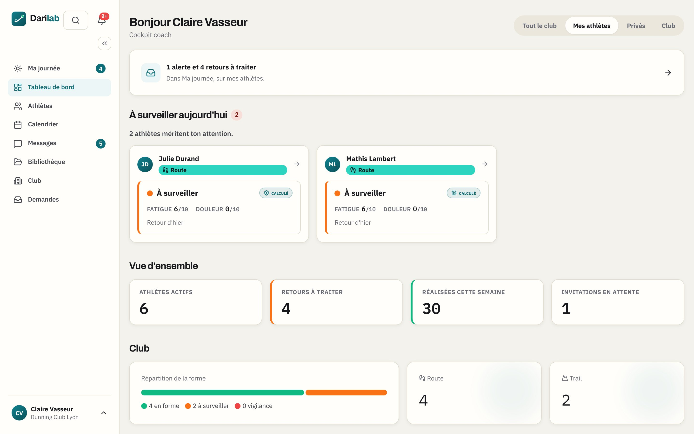

En arrivant, le tableau de bord dit **qui mérite votre attention aujourd'hui** : les athlètes dont
la fatigue ou la douleur monte, ceux qui ne donnent plus de nouvelles, et le nombre de retours de
séance qui attendent votre lecture. La pastille de forme se calcule à partir de la fatigue et de
la douleur déclarées par l'athlète — jamais de l'effort perçu seul.

### Ma journée : trier les retours

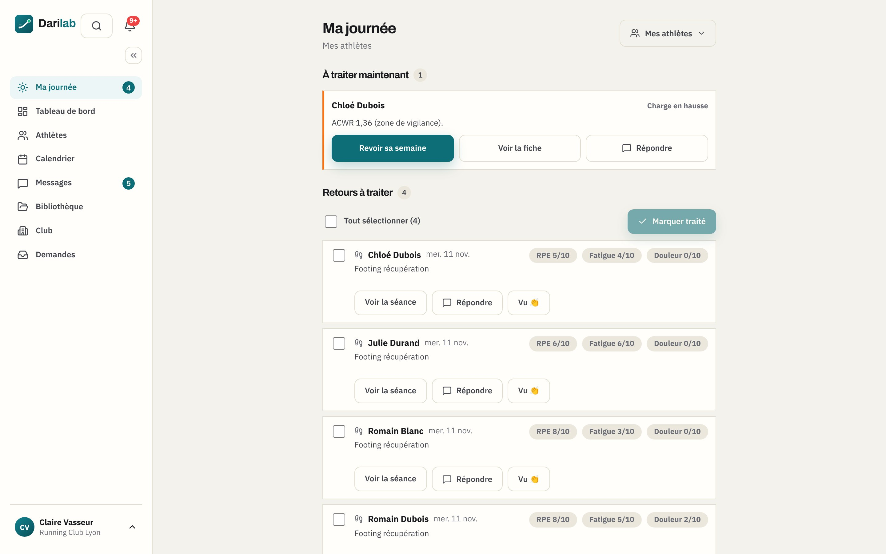

« Ma journée » rassemble ce qui demande une action : en haut ce qui est à traiter maintenant (une
charge qui grimpe trop vite, par exemple), puis chaque retour de séance avec l'effort, la fatigue
et la douleur notés par l'athlète. Pour chacun : ouvrir la séance, répondre, ou simplement
signaler que vous l'avez vu (« Vu 👏 »). On peut aussi tout marquer comme traité d'un coup.

---

## 2. Suivre chaque athlète

### La liste des athlètes

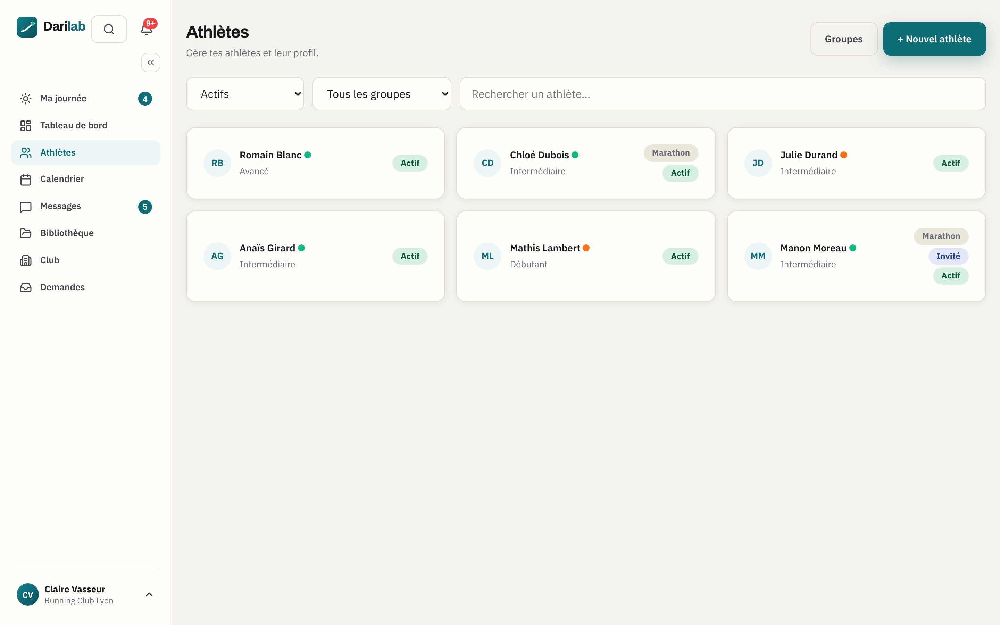

Chaque carte montre le niveau, le groupe et l'état de forme. On filtre par groupe ou par statut,
et on invite un nouvel athlète par e-mail depuis « + Nouvel athlète ».

### La fiche athlète

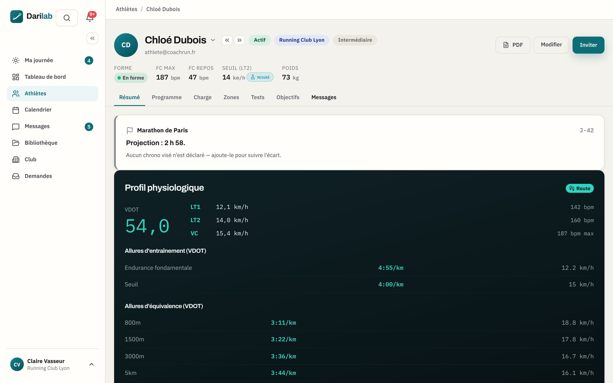

La fiche réunit le profil physiologique (VDOT, seuils, fréquences cardiaques), les allures
d'entraînement qui en découlent, l'objectif de course et sa projection de chrono. Les onglets
mènent au programme, à la charge, aux zones, aux tests, aux objectifs, aux activités et aux
messages de l'athlète.

| Programme | Charge |
|---|---|
| 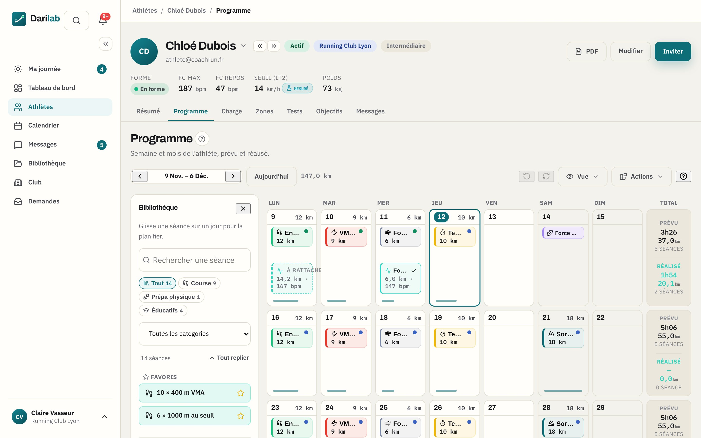 | 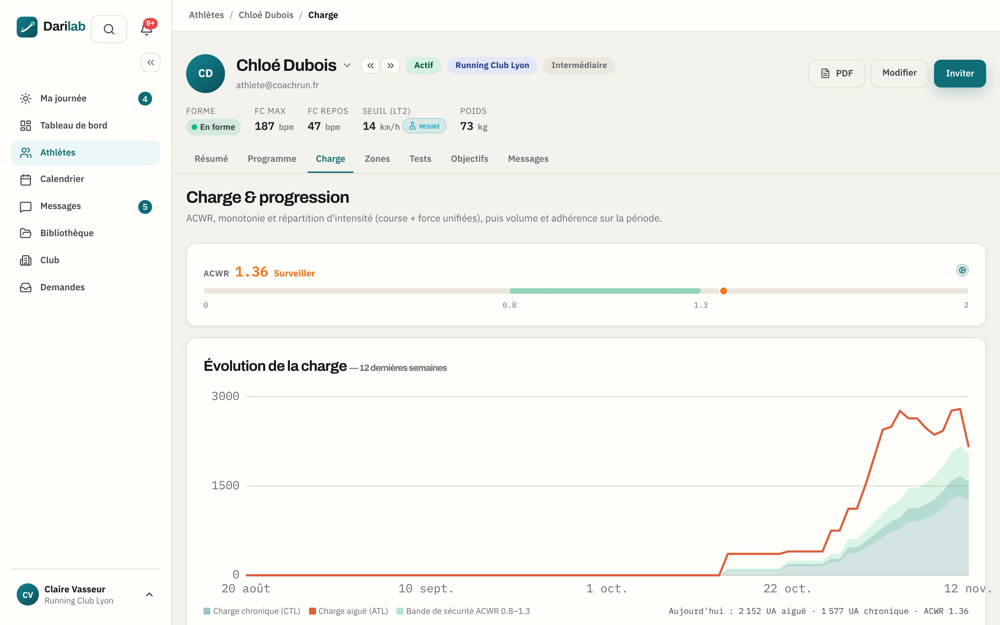 |

- **Programme** : le calendrier de l'athlète, avec la bibliothèque à côté pour glisser une séance
  sur un jour. Chaque semaine affiche son total prévu et réalisé.
- **Charge** : l'évolution de la charge d'entraînement sur douze semaines et le ratio de charge
  aiguë / chronique, pour voir venir le surmenage.
- **Zones** : les records de l'athlète et les allures qu'on en déduit. Saisir un nouveau record
  recalcule tout.

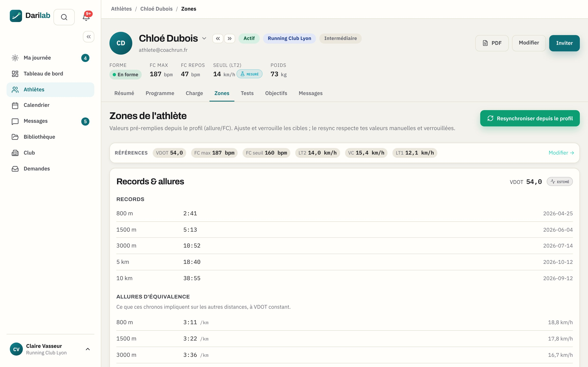

---

## 3. Planifier

### Le calendrier

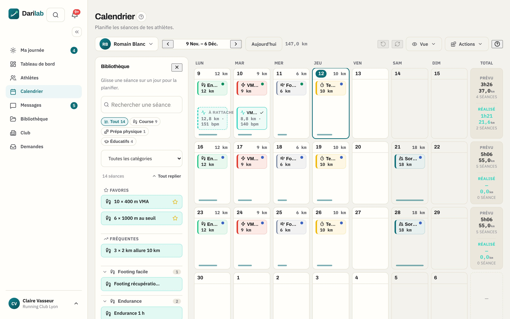

Le calendrier se lit semaine par semaine, pour un athlète ou pour un groupe. On y glisse les
séances de la bibliothèque, on les copie-colle d'un jour ou d'un athlète à l'autre, et l'on
duplique une semaine entière. Une séance copiée chez un autre athlète voit ses allures
**recalculées pour lui**.

### La bibliothèque de séances

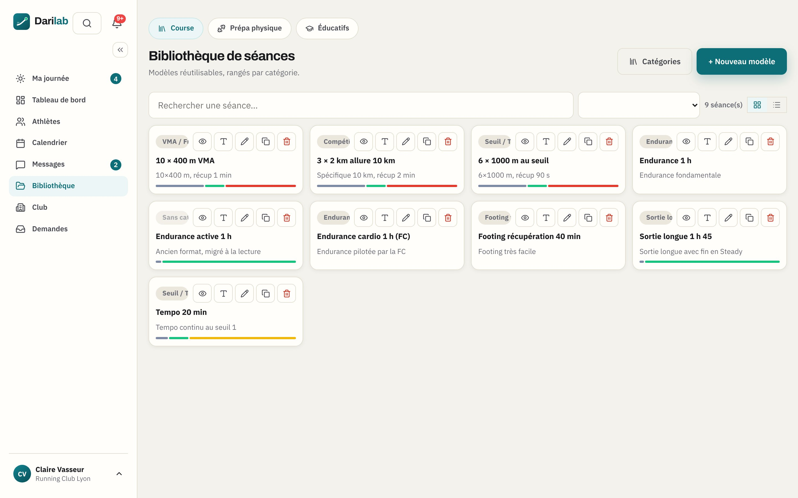

Vos séances types, rangées par catégorie : course, préparation physique et éducatifs. Une séance
se prescrit **en fourchettes** (« 6 × 1000 m entre 102 et 106 % de la vitesse critique ») ; chaque
athlète reçoit les allures qui correspondent à son propre profil.

---

## 4. Échanger

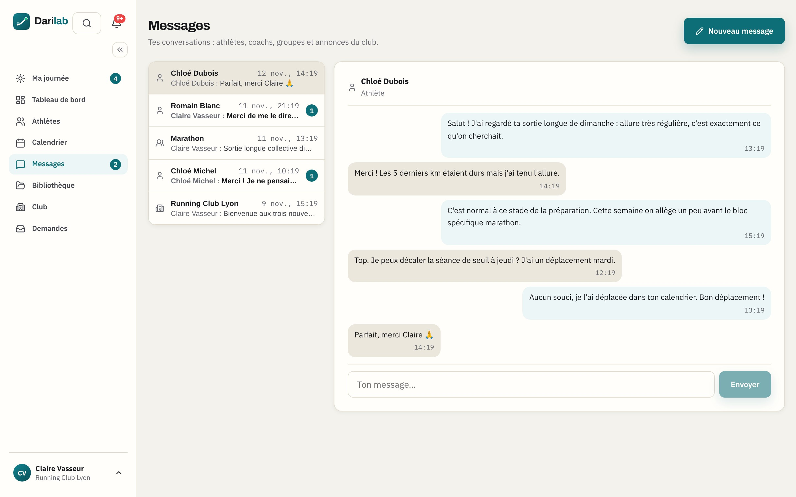

Une conversation par athlète, plus un fil par groupe et un fil pour tout le club (les annonces).
L'athlète écrit depuis son téléphone ; vous recevez une notification.

---

## 5. Trouver de nouveaux athlètes

### Votre fiche publique

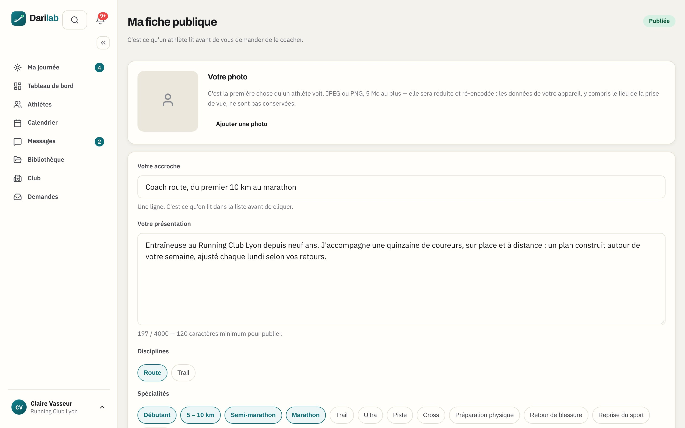

Dans « Ma fiche publique », vous présentez votre approche, vos spécialités, vos tarifs et vos
diplômes. Une fois relue par l'équipe DARI Lab, la fiche apparaît dans l'annuaire public.

| L'annuaire, vu par un visiteur | Votre fiche, vue par un visiteur |
|---|---|
| 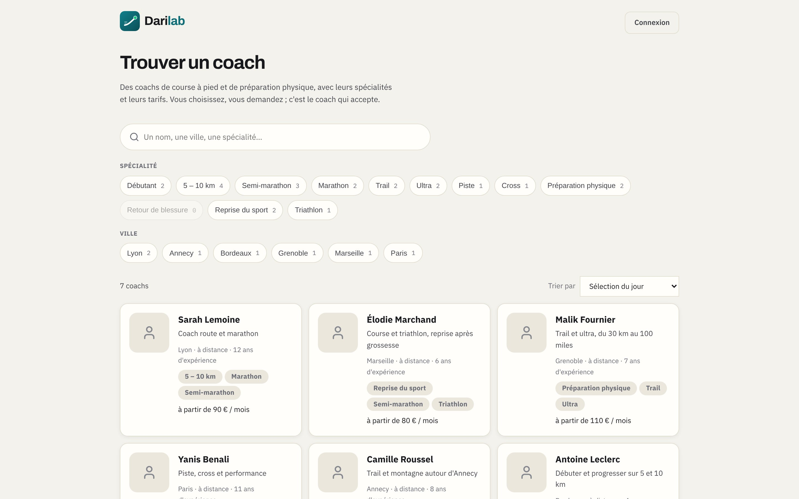 | 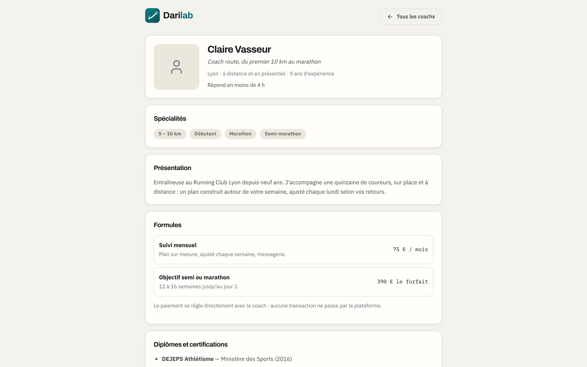 |

### Les demandes de coaching

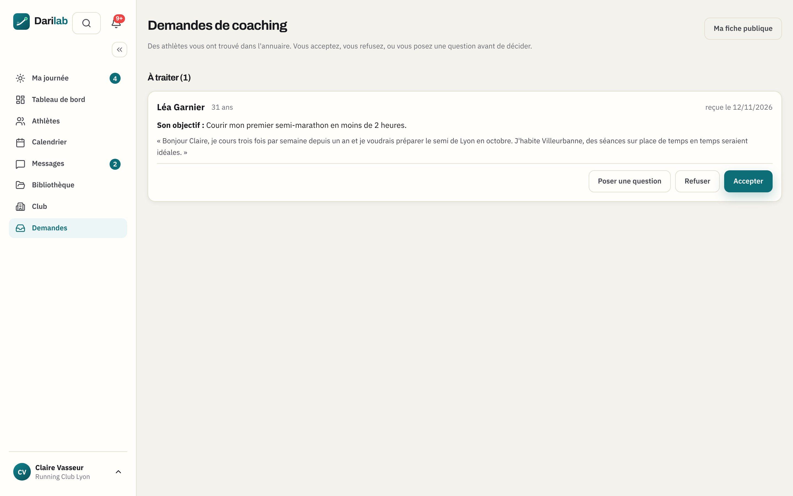

Un athlète qui vous trouve dans l'annuaire vous envoie une demande avec son objectif et un
message. Vous acceptez, vous refusez, ou vous posez d'abord une question. Une demande acceptée
fait entrer l'athlète dans votre espace, prêt à être planifié. Vos coordonnées ne sont jamais
affichées : tout passe par la demande.
